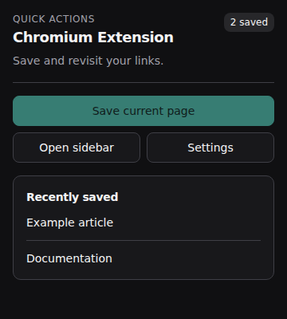
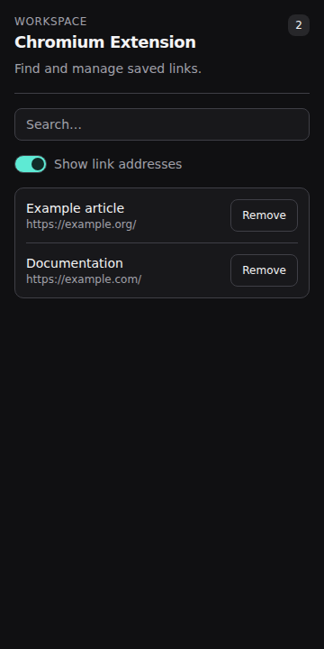

# Interfaces and menus

The template includes selectable browser surfaces. Both profiles use the same Svelte UI foundation.

| Interface | Clean starter | Saved-link demonstration |
| --- | --- | --- |
| Toolbar popup | Open sidebar and settings | Save current page and recent links |
| Sidebar | Product workspace shell | Search and remove saved links; toggle addresses |
| Settings | Appearance and enabled browser capabilities | Same, with sample capability explanations |
| Webpage right-click | Extension settings, if enabled | Save this page |
| Link right-click | No sample action | Save link |
| Toolbar-icon right-click | Settings and Open sidebar, if enabled | Save current page, Open sidebar, Open settings |

The background worker registers native context menus on installation. The clean profile wires actions in `src/background/index.ts`; the demonstration uses `src/example/menus.ts`. Register listeners synchronously when the worker starts.

Chromium owns the appearance of webpage and toolbar context menus. Tailwind cannot theme browser-native chrome. The extension's light/dark preference controls its own pages, not the browser's menus.

## Optional capabilities

- Keyboard shortcuts: the demo saves the active page with the suggested Alt+Shift+S; the clean profile provides a command scaffold.
- Toolbar badge: the demo displays the saved-link count; the reusable helper is available to clean projects.
- Optional permissions: the settings example lets users grant or revoke notification access without sending notifications.
- Content scripts: an isolated-world entry point, initially scoped to example.com when enabled.

See [Configuration](Configuration) for permissions and feature selection.

## Visual examples

The repository gallery includes actual rendered pages and native menus:

- [Clean starter](https://github.com/RuchirChawdhry/copier-chrome-extension/tree/main/screenshots/clean)
- [Saved-link demonstration](https://github.com/RuchirChawdhry/copier-chrome-extension/tree/main/screenshots/demo)
- [Webpage context menu](https://github.com/RuchirChawdhry/copier-chrome-extension/blob/main/screenshots/demo/context-menu-page-dark.png)
- [Link context menu](https://github.com/RuchirChawdhry/copier-chrome-extension/blob/main/screenshots/demo/context-menu-link-dark.png)
- [Toolbar context menu](https://github.com/RuchirChawdhry/copier-chrome-extension/blob/main/screenshots/demo/context-menu-toolbar-dark.png)

Native menu captures use headed Linux Chromium, not Windows Edge. Menu labels and visibility are verified; the capture workflow does not exercise every action.
