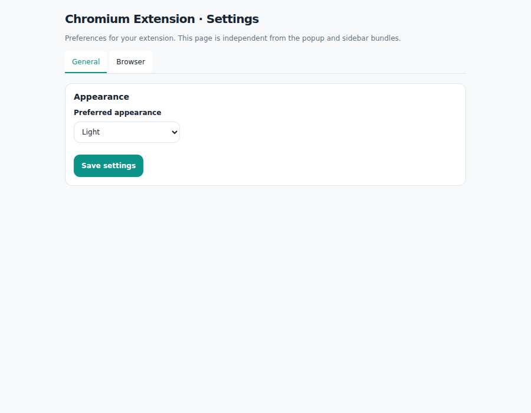
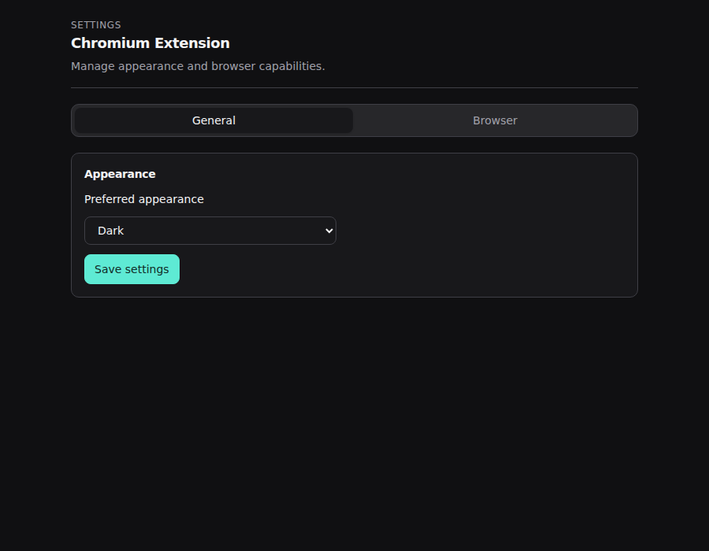

# Themes and styling

The current main branch uses Tailwind CSS v4 compiled by the Vite plugin. It follows shadcn-svelte semantic theming conventions with locally authored Svelte 5 controls; it does not import React or official shadcn registry components.

## Shared theme

`src/ui/styles.css` defines semantic light and dark colors, system-font typography, focus styling and radius tokens. Appearance can follow the system or be explicitly light or dark. The choice is persisted under `ui.theme`.

Use semantic utilities such as `bg-card`, `text-foreground`, `text-muted-foreground`, `border-border` and `bg-primary`. Do not introduce independent palettes in individual screens.

| Token | Light | Dark |
| --- | --- | --- |
| Background | #F5F5F6 | #101012 |
| Card | #FFFFFF | #18181B |
| Foreground | #18181B | #F4F4F5 |
| Border | #D4D4D8 | #3F3F46 |
| Primary | #0F766E | #5EEAD4 |

## Components

The shared Surface component provides page headers, descriptions, spacing and readiness markers. Reuse Button, Card, StatePanel, Status, SearchField, Toggle, Tabs, Dialog and PermissionPanel. Use keyboard-accessible native controls and visible focus. Distinguish loading, empty and error states, and disable duplicate submissions during pending operations.

The toolbar popup is 360 pixels wide; settings use a wider layout. Keep independent bundles and avoid external font requests. Tailwind is a build dependency, not an additional runtime compiler.

## Visual validation

The screenshot workflow checks computed colors, header spacing, typography and control dimensions. Native Chromium context menus inherit browser styling, not these semantic tokens.

See [Interfaces and Menus](Interfaces-and-Menus) and [Testing and CI](Testing-and-CI).
